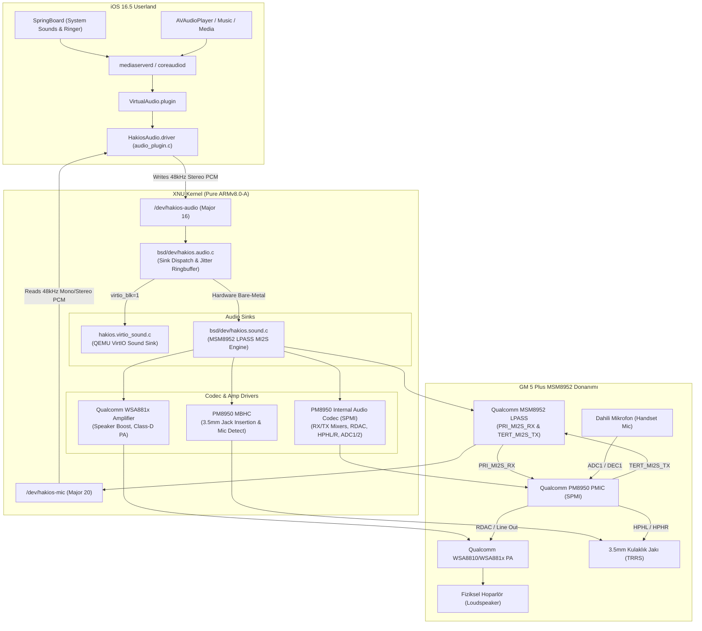

# HackiOS (GM 5 Plus / MSM8952 -> iOS 16.5) Ses Alt Sistemi Kapsamlı Mühendislik Dosyası (Audio Subsystem Dossier)

**Tarih:** 27 Ekim 2026  
**Hedef Cihaz:** General Mobile GM 5 Plus (`shamrock` / `seed_mt`)  
**SoC & Mimari:** Qualcomm Snapdragon 617 (MSM8952 / APQ8052) | 8x ARM Cortex-A53 (ARMv8.0-A, 64-bit) | 3GB LPDDR3 RAM  
**Hedef İşletim Sistemi:** Apple iOS 16.5 Darwin/XNU (`xnu-8796.121.2` ARM64 Pure ARMv8.0-A)  
**Kullanıcı Arayüzü / HAL:** Apple CoreAudio `mediaserverd` / `VirtualAudio.plugin` / `HakiosAudio.driver` (`audio_plugin.c`)  
**Mevcut Durum:** Batarya (`hakios.battery.c`), Haptik (`hakios.haptic.c`), Arka Işık (`hakios.backlight.c`), Dokunmatik (`hakios.goodix.c`), Tuşlar (`hakios.buttons.c`), Depolama (`hakios.sdhci.c`) ve USB hazır. Sıradaki hedef: **Ses Alt Sistemi (Hoparlör, Kulaklık, Mikrofon)**.

---

## 1. Yönetici Özeti ve Mevcut Durum Analizi

HackiOS projesinde kullanıcı alanı (iOS 16.5 userland) ile çekirdek (XNU) arasındaki ses haberleşmesi şu şekilde tasarlanmıştır:
- iOS 16.5'in yerel ses sunucusu olan `mediaserverd` / `coreaudiod`, `/System/Library/Audio/Plug-Ins/HAL/HakiosAudio.driver` (`userland/src/audio_plugin.c`) eklentisini yükler.
- Bu HAL eklentisi iOS'a dört sanal aygıt tanıtır:
  1. **"Speaker":** iOS tarafından mikslenmiş 48.000 Hz, 16-bit stereo PCM örneklerini `/dev/hakios-audio` karakter aygıtına yazar (1024 çerçeve = 4096 baytlık bloklar halinde ~21.33 ms aralıklarla).
  2. **"Hawking":** iOS `VirtualAudio.plugin` routing tablosunun gereksinim duyduğu sessiz yardımcı giriş.
  3. **"Actuator":** iOS Taptic Engine / CoreHaptics motor dalga biçimlerini `/dev/hakios-haptic` aygıtına yazar.
  4. **"Codec":** Dahili mikrofon için `/dev/hakios-mic` aygıtından 48.000 Hz 16-bit PCM okur (`AVAudioRecorder`, Siri, telefon aramaları).
- Çekirdek tarafında `/dev/hakios-audio` (`bsd/dev/hakios.audio.c`), yazılan örnekleri dinamik olarak kayıtlı bir "sink" sürücüsüne teslim eder. QEMU testlerinde `bsd/dev/hakios.virtio_sound.c` (VirtIO Sound Device) başarıyla çalışmaktadır.

### Eski Kod Tablosunun Kritik Sorunu (Neden Yeniden Yazılmalı?):
HackiOS kaynak ağacındaki mevcut fiziksel ses sürücüleri (`bsd/dev/hakios.sound.c`, `bsd/dev/hakios.speaker.c`, `bsd/dev/hakios.mic.c`, `bsd/dev/hakios.adsp.c`), **POCO X5 Pro (`redwood` - Snapdragon 778G / SM7325)** için yazılmıştır. Bu sürücüler:
- Qualcomm SM7325 LPASS TDM port `0x9000` ve SMMU sid `0x1801`,
- IPCC Mailbox Client 3 ve GLINK / QRTR protokolleri,
- Bolero TX/RX makroları ve SoundWire WCD938x kodek,
- I2C üzerinden kontrol edilen harici çift Awinic AW88261 akıllı amfi
üzerine kuruludur.

**GM 5 Plus (`shamrock` / MSM8952) ise tamamen farklı bir ses mimarisine sahiptir:**
- **Ses Kartı:** `msm8952-l9300-snd-card`
- **Mixer Yapılandırması:** `mixer_paths_l9300.xml`
- **Ses Veriyolu:** Primary MI2S (`PRI_MI2S_RX` - Çalma) ve Tertiary MI2S (`TERT_MI2S_TX` - Kayıt)
- **Kodek:** Qualcomm PM8950 Dahili Analog/Dijital Kodek (`codec_type="internal"`)
- **Hoparlör Amfisi:** Qualcomm WSA8810 / WSA881x (`wsa881x.0f` / `wsa-speaker`)
- **Fiziksel Kulaklık:** 3.5 mm TRRS jakı (`HPHL`, `HPHR`) ve PM8950 MBHC (Multi-Button Headset Control).

---

## 2. Mimari Genel Bakış ve Veri Akışı



---

## 3. GM 5 Plus (`shamrock`) Donanım ve XML Kanıtları

Android vendor ağacından (`shamrock-device/audio/`) çıkarılan kanıtlar:

### A. Ses Kartı ve Profiller (`system.prop` & `proprietary-files.txt`)
- Ses Kartı Adı: `msm8952-l9300-snd-card`
- ACDB Kalibrasyon Dosyaları:
  - `persist.audio.calfile0=/etc/acdbdata/shamrock/msm8952-l9300-snd-card/shamrock_Bluetooth_cal.acdb`
  - `persist.audio.calfile1=/etc/acdbdata/shamrock/msm8952-l9300-snd-card/shamrock_General_cal.acdb`
  - `persist.audio.calfile2=/etc/acdbdata/shamrock/msm8952-l9300-snd-card/shamrock_Global_cal.acdb`
  - `persist.audio.calfile3=/etc/acdbdata/shamrock/msm8952-l9300-snd-card/shamrock_Handset_cal.acdb`
  - `persist.audio.calfile4=/etc/acdbdata/shamrock/msm8952-l9300-snd-card/shamrock_Hdmi_cal.acdb`
  - `persist.audio.calfile5=/etc/acdbdata/shamrock/msm8952-l9300-snd-card/shamrock_Headset_cal.acdb`
  - `persist.audio.calfile6=/etc/acdbdata/shamrock/msm8952-l9300-snd-card/shamrock_Speaker_cal.acdb`

### B. Çalma ve Kayıt Veriyolu Yolları (`mixer_paths_l9300.xml`)
1. **Hoparlör Yolu (`wsa-speaker`):**
   ```xml
   <path name="wsa-speaker">
       <ctl name="RX1 MIX1 INP1" value="RX1" />
       <ctl name="RDAC2 MUX" value="RX1" />
       <ctl name="RX1 Digital Volume" value="84" />
       <ctl name="WSA Spk Switch" value="WSA" />
       <ctl name="SpkrMono WSA_RDAC" value="Switch" />
   </path>
   ```
2. **Kulaklık Yolu (`headphones`):**
   ```xml
   <path name="headphones">
       <ctl name="MI2S_RX Channels" value="Two" />
       <ctl name="RX1 MIX1 INP1" value="RX1" />
       <ctl name="RX2 MIX1 INP1" value="RX2" />
       <ctl name="RDAC2 MUX" value="RX2" />
       <ctl name="HPHL" value="Switch" />
       <ctl name="HPHR" value="Switch" />
   </path>
   ```
3. **Dahili Mikrofon Yolu (`handset-mic` & `adc1`):**
   ```xml
   <path name="handset-mic">
       <path name="adc1" />
       <ctl name="IIR1 INP1 MUX" value="DEC1" />
   </path>
   <path name="adc1">
       <ctl name="ADC1 Volume" value="6" />
       <ctl name="DEC1 MUX" value="ADC1" />
   </path>
   ```
4. **Kulaklık Mikrofonu Yolu (`headset-mic` & `adc2`):**
   ```xml
   <path name="headset-mic">
       <path name="adc2" />
       <ctl name="ADC2 MUX" value="INP2" />
       <ctl name="IIR1 INP1 MUX" value="DEC1" />
   </path>
   <path name="adc2">
       <ctl name="ADC2 Volume" value="6" />
       <ctl name="DEC1 MUX" value="ADC2" />
   </path>
   ```
5. **Backend Mikser Yolları:**
   - Çalma: `PRI_MI2S_RX Audio Mixer MultiMedia1` -> Değer: 1
   - Kayıt: `MultiMedia1 Mixer TERT_MI2S_TX` -> Değer: 1

### C. Donanım Aygıt Bilgisi (`audio_platform_info.xml`)
- Çıkış Bit Genişliği: 24-bit / 16-bit
- Dahili Kodek Tanımı:
  - `<device name="AUDIO_DEVICE_IN_BUILTIN_MIC" interface="TERT_MI2S" codec_type="internal"/>`
  - `<device name="AUDIO_DEVICE_IN_BACK_MIC" interface="TERT_MI2S" codec_type="internal"/>`
- Akıllı Amfi Donanımı:
  - `<device name="SND_DEVICE_OUT_SPEAKER" spkr_1_tz_name="wsa881x.0f" spkr_2_tz_name=""/>`

---

## 4. Büyük Modele (Frontier Reasoning Model) Sorulacak 6 Kritik Mühendislik Sorusu

Aşağıdaki sorular, XNU çekirdeğinde GM 5 Plus ses sürücülerini sıfırdan ve eksiksiz bir şekilde yazabilmemiz için büyük modele (o3-mini / Claude 3.5 Sonnet / GPT-4o) yöneltilmek üzere hazırlanmıştır:

### Soru 1: SoC LPASS vs QDSP6 Hexagon ADSP Mimari Rota Seçimi
MSM8952 (Snapdragon 617) yonga setinde ses sinyali işlemcisi ve LPASS (Low Power Audio Subsystem) kontrolü için iki olası yol bulunmaktadır:
- **Rota A (Bare-Metal Doğrudan Host LPASS MI2S + DMA):**
  - Mainline Linux çekirdeğinde (`sound/soc/qcom/lpass-cpu.c`, `lpass-apq8016.c`, `lpass-msm8916.c`), Cortex-A53 çekirdekleri LPASS register bloklarına (`0x07708000` veya `0x07700000`) doğrudan MMIO erişimi yaparak MI2S bit saatini, word select sinyalini ve dahili DMA dairesel tamponunu (ring buffer) Hexagon ADSP yazılımını yüklemeden kontrol edebilmektedir.
  - *Soru:* MSM8952 üzerinde TrustZone (QSEE), LPASS register MMIO alanlarına Cortex-A53'ün Güvenli Olmayan (Non-Secure) dünyadan erişmesine izin verir mi, yoksa bus fault / external abort mu tetikler? Eğer doğrudan MMIO erişimi mümkünse, MSM8952 LPASS `PRI_MI2S_RX` ve `TERT_MI2S_TX` register adresleri, bitclock bölücüleri ve DMA konfigürasyon register haritası nedir?
- **Rota B (Hexagon QDSP6 v56 ADSP + SMD Üzerinden APR v2):**
  - Eğer TrustZone LPASS registerlarını kilitliyorsa, ADSP firmware (`adsp.mdt`, `adsp.b*`) PIL (Peripheral Image Loader) ve TrustZone SCM çağrıları ile önyüklenmelidir.
  - *Soru:* MSM8952'de ADSP önyüklemesi için SCM PAS ID'si nedir (PAS ID 1 mi, 4 mü)? ADSP başladıktan sonra açılan SMD (Shared Memory Driver) kanalı hangisidir (`apr_audio_svc` mi)? AFE (Audio Front End - Service 4), ADM (Service 8) ve ASM (Audio Stream Manager - Service 7) servislerine gönderilecek AFE Port ID (`0x1000` / `PRIMARY_MI2S_RX`) ve ses akışı başlatma APR paket formatı nedir?

### Soru 2: PM8950 Dahili Ses Kodeki SPMI Register Haritası ve Başlatma Dizisi
GM 5 Plus, harici WCD9330/WCD9335 kodek yerine doğrudan **Qualcomm PM8950 dahili ses kodekini** (`codec_type="internal"`) kullanmaktadır.
- *Soru:* PM8950 dahili analog ve dijital kodek çevre birimleri (peripherals) SPMI veriyolunda hangi Slave ID (0 veya 1) ve hangi Base Register adreslerinde yer alır (örn. Dijital blok `0xF000`, Analog blok `0xF100`, MBHC `0xF200` vb.)?
- *Soru:* `mixer_paths_l9300.xml` dosyasında görülen şu mikser kontrollerinin birebir SPMI register adresleri, bit maskeleri ve değerleri nelerdir:
  - `RX1 MIX1 INP1 = RX1`
  - `RDAC2 MUX = RX1` (Hoparlör için) veya `RX2` (Kulaklık için)
  - `RX1 Digital Volume = 84`
  - `HPHL = Switch` ve `HPHR = Switch` (Class-H kulaklık amfisi açma)
  - `ADC1 Volume = 6` ve `DEC1 MUX = ADC1` (Dahili mikrofon analog ön amfi ve desimatör)
  - `MICBIAS1` gerilim seçimi (1.8V vs 2.85V) ve etkinleştirme?
- *Soru:* Hoparlör ve kulaklık açılışında rahatsız edici "pop / click" gürültülerini önlemek için izlenmesi gereken doğru register güç verme (power-up) ve soft-ramp zamanlama dizisi nedir?

### Soru 3: Qualcomm WSA8810 / WSA881x Akıllı Hoparlör Amfisi Entegrasyonu
`audio_platform_info.xml` dosyasında hoparlör donanımı olarak `<device name="SND_DEVICE_OUT_SPEAKER" spkr_1_tz_name="wsa881x.0f"/>` tanımlanmıştır. `mixer_paths_l9300.xml` dosyasında ise:
`<ctl name="WSA Spk Switch" value="WSA" />` ve `<ctl name="SpkrMono WSA_RDAC" value="Switch" />` kontrolleri mevcuttur.
- *Soru:* GM 5 Plus anakartı üzerinde WSA8810/WSA8815 akıllı amfi SoC'ye/PMIC'e hangi fiziksel arayüzle bağlıdır?
  1. SoundWire (SWR) veriyolu mu?
  2. PM8950 CDC analog hat çıkışı (Line-Out / RDAC2) + GPIO/I2C kontrolü mü?
  3. SPMI veya doğrudan analog fark sinyali (differential analog input) mi?
- *Soru:* WSA881x yongasının başlatılması, dahili DC-DC boost konvertörünün 5V/5.5V seviyesine çıkarılması, kazanç (gain) ayarı ve hoparlör empedans/termal koruma registerlarının bare-metal C dilinde konfigürasyonu nasıl yapılır?

### Soru 4: Dahili Mikrofon (Handset Mic) ve XNU `/dev/hakios-mic` Akışı
Kullanıcı alanındaki `audio_plugin.c` HAL sürücüsü, iOS 16.5'in yerel ses kayıt mekanizmaları (`AVAudioRecorder`, Siri, Telefon, Ses Kaydedici) için `/dev/hakios-mic` (Major 20) karakter aygıtından PCM okuması yapmaktadır.
- *Soru:* `ADC1` -> `DEC1` -> `TERT_MI2S_TX` yolunda PM8950 mikrofon analog ön amfisi (pre-amp), bias gerilimi (`MICBIAS1`) ve MSM8952 Tertiary MI2S TX DMA alıcı halkası nasıl yapılandırılır?
- *Soru:* iOS CoreAudio `audio_plugin.c` tarafındaki `codec_read()` fonksiyonu ne tür bir PCM formatı (örneğin 48.000 Hz, 16-bit Mono, Little-Endian) ve nasıl bir tampon boyutu / zamanlama bekler? Çekirdekte mikrofon okumasının bloklayıcı (blocking) mı yoksa dairesel fifo (circular FIFO) üzerinden mi sunulması gerekir?

### Soru 5: 3.5 mm Fiziksel Kulaklık Jakı ve PM8950 MBHC Algılama Mekanizması
GM 5 Plus üzerinde standart 3.5 mm TRRS (Tip-Ring-Ring-Sleeve) kulaklık soketi bulunmaktadır.
- *Soru:* PM8950 dahili MBHC (Multi-Button Headset Control) çevresel bloğu jak takılmasını (insertion) ve çıkarılmasını (removal) nasıl algılar?
- *Soru:* Jak algılandığında 3 kutuplu (TRS - mikrofon yok) ve 4 kutuplu (TRRS - mikrofonlu kulaklık) ayrımı için empedans ölçüm registerları nasıl okunur?
- *Soru:* Jak takıldığında veya çıkarıldığında, iOS tarafında `VirtualAudio.plugin` / `audio_plugin.c` düzeyinde ses rotasını anlık olarak "Speaker" ile "Headphones" arasında dinamik değiştirmek için hangi CoreAudio veya IOKit bildirim mekanizması tetiklenmelidir?

### Soru 6: Gerçek Zamanlı Pacing, Jitter-Free Dairesel Halka Tamponu (Ring Buffer) ve QEMU Uyumluluğu
iOS 16.5 `mediaserverd` gerçek zamanlı bir Mach iş parçacığı üzerinden her ~21.33 ms'de bir 1024 çerçeve (4096 bayt) yazar.
- *Soru:* MSM8952 fiziksel donanım DMA'sının underflow (ses kesintisi/cızırtı) veya overflow (gecikme/ses kaybı) yaşamaması için `bsd/dev/hakios.audio.c` içinde lockless veya mutex korumalı kaç milisaniyelik (örn. 40-60 ms, 2-3 periyotluk ping-pong DMA) bir dairesel tampon mimarisi kurulmalıdır?
- *Soru:* Sürücünün çift modlu yapısı (Dual-mode execution): QEMU virt modunda (`virtio_blk=1`) mevcut VirtIO Sound Device (`hakios.virtio_sound.c`) çalışmaya devam ederken, bare-metal MSM8952 donanımında MSM8952 LPASS/WSA amfisine yönlenmesi nasıl organize edilmelidir?

---

## 5. Uygulama ve Dosya Yapısı Yol Haritası

Frontier modelden gelecek yanıt doğrultusunda şu dosyalarda güncelleme yapılacaktır:

| Dosya Yolu | Rolü ve Yapılacak İşlem |
| :--- | :--- |
| `bsd/dev/hakios.audio.c` | `/dev/hakios-audio` karakter aygıtı, ses seviyesi ioctl'i, gerçek zamanlı halka tampon (ring buffer) ve sink dağıtımı. |
| `bsd/dev/hakios.sound.c` | MSM8952 LPASS MI2S denetleyicisi, saat yapılandırması ve DMA tampon yönetimi. |
| `bsd/dev/hakios.speaker.c` | PM8950 dahili analog kodek (SPMI) ve Qualcomm WSA881x hoparlör amfisi sürücüsü. |
| `bsd/dev/hakios.mic.c` | PM8950 ADC1/DEC1 ve TERT_MI2S mikrofon kayıt sürücüsü (`/dev/hakios-mic`). |
| `userland/src/audio_plugin.c` | iOS HAL eklentisinde kulaklık jakı rota geçişi ve ses akışı senkronizasyonu. |
| `userland/src/sound_test.c` | Kullanıcı alanında test tonu, sistem sesleri ve SpringBoard ses doğrulama testi. |

---

## 6. Büyük Modele Gönderilecek Doğrudan Prompt Metni

Aşağıdaki blok, yukarıdaki tüm teknik kanıtları ve 6 kritik mühendislik sorusunu tek parça halinde içermekte olup, doğrudan büyük akıl yürütme modeline (o3-mini / Claude 3.5 Sonnet / GPT-4o) gönderilmek üzere hazırlanmıştır:

```markdown
# HackiOS Project Engineering Query: Audio Subsystem Bring-up on Qualcomm MSM8952 (Snapdragon 617) running Apple iOS 16.5 Darwin/XNU

### Context:
We are porting Apple iOS 16.5 (Darwin/XNU kernel `xnu-8796.121.2` compiled for pure ARMv8.0-A Cortex-A53, 4KB page size, GICv2, no hardware PAC) to the General Mobile GM 5 Plus (`shamrock` / `seed_mt`).
Battery telemetry (`hakios.battery.c` -> `IOPMPowerSource`), Haptic engine (`hakios.haptic.c` -> `/dev/hakios-haptic`), LCD backlight (`hakios.backlight.c`), Goodix touch (`hakios.goodix.c`), Buttons (`hakios.buttons.c`), SDHCI eMMC/MicroSD (`hakios.sdhci.c`), USB, and VirtIO devices are already fully working.

We are now implementing the **Audio Subsystem** (Loudspeaker, 3.5mm Headphone Jack, Handset/Headset Microphones, and CoreAudio integration).

### Userland Contract (iOS 16.5 side):
Our iOS HAL plugin (`userland/src/audio_plugin.c` -> `HakiosAudio.driver`) provides:
1. "Speaker" -> Writes 48,000 Hz, 16-bit stereo little-endian PCM (1024 frames = 4096 bytes per buffer, every ~21.33 ms) to `/dev/hakios-audio`.
2. Volume Control -> Sends `ioctl(HAKIOS_AUDIO_SET_VOLUME)` with `below` (in eighths of a dB attenuation) and `muted` flag.
3. "Codec" -> Reads 48,000 Hz PCM from `/dev/hakios-mic` for microphone input (`AVAudioRecorder`, Siri, Phone).
4. Dual-mode support -> In QEMU virt mode (`virtio_blk=1`), audio is routed to QEMU's virtio-sound sink (`hakios.virtio_sound.c`). On bare-metal MSM8952 hardware, it must drive the real physical audio pipeline.

### Ground Truth Hardware Extraction from GM 5 Plus (`shamrock`):
- **SoC:** Qualcomm Snapdragon 617 (MSM8952 / APQ8052)
- **Sound Card:** `msm8952-l9300-snd-card`
- **Mixer Configuration:** `mixer_paths_l9300.xml`
- **Audio Platform Config:** `audio_platform_info.xml`
- **Playback Bus:** Primary MI2S (`PRI_MI2S_RX`, `PRI_MI2S_RX Audio Mixer MultiMedia1`)
- **Capture Bus:** Tertiary MI2S (`TERT_MI2S_TX`, `MultiMedia1 Mixer TERT_MI2S_TX`)
- **Internal Codec:** Qualcomm PM8950 Internal Analog & Digital Codec (`codec_type="internal"`)
- **Speaker Path in XML:**
  `PRI_MI2S_RX` -> `RX1 MIX1 INP1 (RX1)` -> `RDAC2 MUX (RX1)` -> `RX1 Digital Volume (84)` -> `WSA Spk Switch (WSA)` -> `SpkrMono WSA_RDAC (Switch)`
- **Headphone Path in XML:**
  `PRI_MI2S_RX` -> `MI2S_RX Channels (Two)` -> `RX1 MIX1 INP1 (RX1)` / `RX2 MIX1 INP1 (RX2)` -> `RDAC2 MUX (RX2)` -> `HPHL (Switch)` / `HPHR (Switch)`
- **Microphone Path in XML:**
  `handset-mic` -> `adc1` (`ADC1 Volume 6`, `DEC1 MUX ADC1`) -> `IIR1 INP1 MUX (DEC1)`
- **Smart Speaker PA in XML:**
  `<device name="SND_DEVICE_OUT_SPEAKER" spkr_1_tz_name="wsa881x.0f" spkr_2_tz_name=""/>`
- **Headphone Jack:** Physical 3.5mm TRRS jack connected to PM8950 MBHC.

---

### Questions for Frontier Model:

#### Question 1: MSM8952 LPASS Architecture — Direct Host MI2S DMA vs QDSP6 ADSP / APR
1. Can the Cortex-A53 directly control MSM8952 LPASS MI2S registers (`0x07708000` / `0x07700000`) and configure a circular DMA ring buffer without loading the Hexagon ADSP firmware (similar to mainline Linux `sound/soc/qcom/lpass-cpu.c` / `lpass-apq8016.c`)? Does Qualcomm TrustZone (QSEE) allow Non-Secure access to LPASS MMIO on MSM8952, or does it trigger an external bus abort?
2. If direct LPASS MMIO is possible, what are the exact register offsets for MSM8952 `PRI_MI2S_RX` and `TERT_MI2S_TX`, clock dividers, and DMA descriptor registers?
3. If TrustZone traps LPASS MMIO and mandates booting the QDSP6 v56 Hexagon ADSP: What is the SCM PIL PAS ID for MSM8952 ADSP (PAS ID 1 or 4)? What SMD channel is used (`apr_audio_svc`)? What are the exact APR v2 packet structures and opcodes to configure AFE port `0x1000` (`PRIMARY_MI2S_RX`) and start an ASM playback stream?

#### Question 2: PM8950 Internal Codec SPMI Register Architecture
1. In PM8950, what are the SPMI Slave ID (0 or 1) and Peripheral Base Addresses for the internal audio codec (Digital Codec, Analog Codec, Class-H RX, Interpolators, Decimators, and MBHC)?
2. What are the exact SPMI register offsets and bitmasks corresponding to:
   - `RX1 MIX1 INP1` and `RDAC2 MUX`
   - Class-H Headphone Amp power-up sequence (`HPHL`, `HPHR`)
   - Volume registers (`RX1 Digital Volume`)
   - `ADC1` pre-amplifier and `DEC1` decimator configuration
   - `MICBIAS1` enable and voltage selection (1.8V vs 2.85V)?
3. What is the precise register sequence to power up the analog outputs smoothly without loud pops, clicks, or DC bias transients?

#### Question 3: Qualcomm WSA881x Speaker Amplifier Interface & Registers
1. On GM 5 Plus, how is the `wsa881x.0f` amplifier wired to the SoC/PMIC? Is it via SoundWire, PM8950 differential analog line-out with I2C control, or SPMI?
2. What is the register initialization sequence for WSA881x: software reset, internal DC-DC boost setup (to ~5.0V), amplifier gain staging, speaker impedance/thermal protection registers, and unmute sequence?

#### Question 4: Microphone Capture Path & CoreAudio Timing
1. How should the kernel configure `ADC1` / `DEC1` / `TERT_MI2S_TX` to stream microphone audio into `/dev/hakios-mic`?
2. What buffering and flow control (e.g. blocking read with condition variable vs non-blocking circular FIFO) should `/dev/hakios-mic` use to satisfy `audio_plugin.c` (`codec_read()`) without stalling the iOS audio server real-time thread?

#### Question 5: 3.5mm Headphone Jack Detection (PM8950 MBHC) & Route Switching
1. What are the PM8950 MBHC registers used to detect plug insertion, removal, and measure impedance to distinguish 3-pole TRS headphones from 4-pole TRRS headsets?
2. When a plug event occurs, how should the kernel notify userland, and what CoreAudio/IOKit API should `audio_plugin.c` use to switch the active audio route seamlessly between "Speaker" and "Headphones"?

#### Question 6: Jitter-Free Audio Ringbuffer & Dual-Mode QEMU Architecture
1. What circular ringbuffer sizing and pacing strategy (e.g., 2 or 3 ping-pong DMA buffers of 1024 frames, 40-60 ms total latency) should be implemented in `bsd/dev/hakios.audio.c` to absorb mach thread scheduling jitter and prevent audio underruns?
2. Provide a clean C design pattern for `bsd/dev/hakios.audio.c` that checks `virtio_blk=1` / `virtio_sound=1` at boot to dispatch audio either to `hakios_virtio_sound_init()` (QEMU) or to `hakios_sound_init()` (bare-metal MSM8952), ensuring zero regressions on automated QEMU test runs.
```
