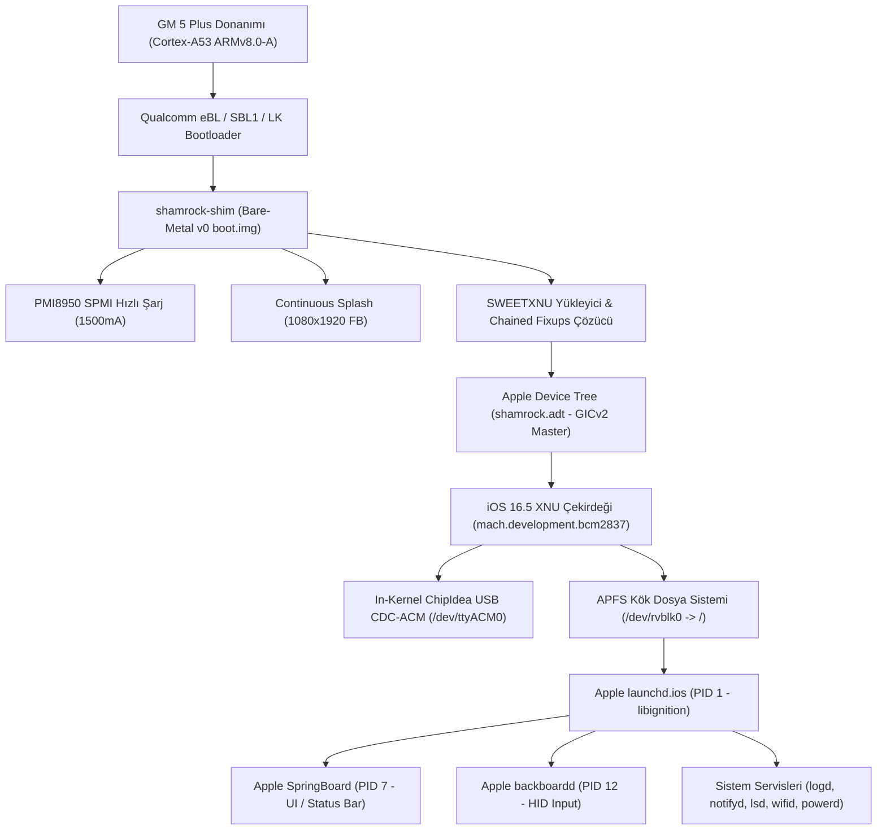

# HackiOS: General Mobile GM 5 Plus (MSM8952) -> iOS 16.5 Darwin/XNU & Userland
## Baştan Sona Kapsamlı Proje Kitabı ve Mühendislik Başvuru Dokümantasyonu

> **Proje:** HackiOS (MSM8952 / Snapdragon 617 üzerinde iOS 16.5 XNU Çekirdeği, Userland, Launchd ve SpringBoard Portu)  
> **Tarih:** 27 Ekim 2026  
> **Hedef Donanım:** General Mobile GM 5 Plus (`shamrock` / `seed_mt`)  
> **İşlemci / Platform:** Qualcomm Snapdragon 617 (MSM8952) – 8× ARM Cortex-A53 (ARMv8.0-A, 64-bit)  
> **Bellek & Depolama:** 3 GB LPDDR3 RAM (`0x90000000` tabanı) | 32 GB eMMC 5.1  
> **Ekran:** 1080×1920 @ 60Hz 32bpp (Continuous Splash / MDP5 DSI)  
> **Hedef Yazılım:** Apple iOS 16.5 Darwin Kernel (`xnu-8796.121.2`) + Apple Stok Userland (`20F66`)  
> **Host Geliştirme Ortamı:** Ubuntu Linux (AMD Ryzen 7 7840HS 8C/16T, 16 GB RAM, NVIDIA RTX 4070)

---

## İçindekiler
1. [Proje Vizyonu ve Mimari Özeti](#1-proje-vizyonu-ve-mimari-özeti)
2. [Aşılan Donanımsal ve Yazılımsal Mimari Kısıtlamalar](#2-aşılan-donanımsal-ve-yazılımsal-mimari-kısıtlamalar)
3. [Faz 1: Çapraz Derleme Ortamı ve Linux-XNU Araç Zinciri](#3-faz-1-çapraz-derleme-ortamı-ve-linux-xnu-araç-zinciri)
4. [Faz 2: Bare-Metal Shim Loader (`shim-shamrock`)](#4-faz-2-bare-metal-shim-loader-shim-shamrock)
5. [Faz 3: Apple Device Tree (ADT) Sentezi](#5-faz-3-apple-device-tree-adt-sentezi)
6. [Faz 4: Çekirdek İçi ChipIdea USB CDC-ACM Canlandırması](#6-faz-4-çekirdek-içi-chipidea-usb-cdc-acm-canlandırması)
7. [Faz 5: Kesme Denetleyici (GICv2) ve Konsol Donmalarının Çözümü](#7-faz-5-kesme-denetleyici-gicv2-ve-konsol-donmalarının-çözümü)
8. [Faz 6: Kullanıcı Alanı (Userland) ve APFS Dosya Sistemi Geçişi](#8-faz-6-kullanıcı-alanı-userland-ve-apfs-dosya-sistemi-geçişi)
9. [Faz 7: Kırılma Noktası — Chained Fixup & `launchd` Kök Neden Analizi](#9-faz-7-kırılma-noktası--chained-fixup--launchd-kök-neden-analizi)
10. [Faz 8: Tarihi Zafer — QEMU Test 41: `launchd.ios` ve `SpringBoard` (PID 7)](#10-faz-8-tarihi-zafer--qemu-test-41-launchdios-ve-springboard-pid-7)
11. [Faz 9: Fiziksel Donanım (GM 5 Plus) Hazırlığı](#11-faz-9-fiziksel-donanım-gm-5-plus-hazırlığı)
12. [Proje Dizin ve Dosya Haritası](#12-proje-dizin-ve-dosya-haritası)

---

## 1. Proje Vizyonu ve Mimari Özeti

Bu projenin temel hedefi; Apple'ın güncel mobil işletim sistemi çekirdeği **iOS 16.5 XNU (`xnu-8796.121.2`)** ile Apple'ın resmi stok kullanıcı alanı ikililerini (`/sbin/launchd.ios`, `/System/Library/CoreServices/SpringBoard.app/SpringBoard`, `backboardd` vb.), Apple Silicon donanımından taban tabana zıt bir yapıya sahip olan **General Mobile GM 5 Plus (Qualcomm Snapdragon 617 / MSM8952)** akıllı telefonunda bare-metal çalıştırmaktır.



---

## 2. Aşılan Donanımsal ve Yazılımsal Mimari Kısıtlamalar

Apple A11+ (Bionic) mimarisi ile Qualcomm Snapdragon 617 arasındaki donanımsal farklar, portlama sürecinde çözülmesi zorunlu olan derin mühendislik engelleri oluşturdu:

| Mimari Katman | Stok iOS 16.5 Hedefi (Apple A11+) | GM 5 Plus (Qualcomm MSM8952) | Mühendislik Çözümümüz |
| :--- | :--- | :--- | :--- |
| **Komut Kümesi (ISA)** | `ARMv8.3-A+` (`arm64e`) Pointer Authentication (PAC) | Standart `ARMv8.0-A` (Donanımsal PAC yok) | XNU derleme bayraklarında `HAS_APPLE_PAC` devre dışı bırakıldı. HINT PAC komutları Cortex-A53'te NOP çalışırken, non-HINT komutlar ayıklandı. |
| **Sayfa Boyutu (Granule)** | 16 KB Donanımsal Sayfa Boyutu (`PAGE_SHIFT = 14`) | 4 KB Donanımsal Sayfa Boyutu (`PAGE_SHIFT = 12`) | `osfmk/arm/arm_init.c` içinde `PAGE_SHIFT_CONST = 12` zorlandı; DSC sliding 4KB için bypass edildi. |
| **Kesme Denetleyici (IRQ)** | Apple AIC (Apple Interrupt Controller) | ARM GICv2 (Qualcomm MSM8952 GIC) | ADT içinde GICv2 master node tanımlandı, generic ARM kesme sürücüsü bağlandı. |
| **Donanım Tanımlama** | Apple Flat Device Tree (ADT) | Linux Flattened Device Tree (FDT / DTB) | `tools/mkadt-shamrock.py` aracıyla Linux DTB donanım haritası Apple ADT formatına dönüştürüldü. |
| **İkili Relokasyonlar** | PIE + `LC_DYLD_CHAINED_FIXUPS` | Flat yükleme bekleyen Android bootloader | `mkpayload.py` ile zincirli fixup'lar statik olarak çözüldü. |
| **Güç & Batarya** | Apple PMGR / SMC | Qualcomm PMI8950 (SPMI Bus) | Shim katmanında SPMI üzerinden PMI8950 USID2 kayıtçıları yazılarak 1.5A hızlı şarj (`FAST_CHG_ACTIVE`) sağlandı. |

---

## 3. Faz 1: Çapraz Derleme Ortamı ve Linux-XNU Araç Zinciri

1. **Araç Zincirinin Kurulumu:**
   - Linux üzerinde Apple XNU çekirdeğini derlemek için Clang tabanlı `xnu-clang`, `cctools-port` (ld64), `mig` ve `iPhoneOS16.5.xnu.sdk` başlıkları sisteme entegre edildi.
2. **Yol (Path) Standardizasyonu:**
   - Host dosya sistemindeki boşluklu dizin (`/media/atakan/Yeni Birim/...`) kaynaklı derleyici ve Make hatalarını kalıcı olarak çözmek için `/home/atakan/GM5PlusPort` ve `/home/atakan/hackios-work` sembolik bağları oluşturuldu.
3. **Paralel Derleme Gücü:**
   - AMD Ryzen 7 7840HS (8 çekirdek / 16 iş parçacığı) donanımı için tüm derleme süreçlerinde `-j16` parametresi standart kural haline getirildi.

---

## 4. Faz 2: Bare-Metal Shim Loader (`shim-shamrock`)

Android'in stok bootloader'ı (`aboot` / LittleKernel), standart Linux `boot.img` başlığı (`header_version 0`) bekler. XNU çekirdeğini doğrudan bootloader'a vermek yerine araya bir bare-metal ara katman yazıldı:

1. **Bare-Metal Başlatıcı:**
   - `start.S` ve `shim.c`: 64-bit EL1 modunda çalışır, MMU'yu hazırlar, AArch64 Page Table (`mmu.c`) kurar ve `SWEETXNU` payload'ını açar.
2. **Qualcomm LittleKernel Uyumluluğu:**
   - `out/Image` dosyasının `0x2C` ofsetine LK'nın aradığı `DTB_OFFSET` boyutu yazıldı ve `shamrock.dtb` (`qcom,msm-id = <264 0x0>`, `qcom,board-id = <0x10008 0>`) ikiliye eklendi.
3. **PMI8950 SPMI Hızlı Şarj Desteği (`shamrock_charger.c`):**
   - Cihazın testler sırasında şarjının bitmemesi için Qualcomm SPMI kayıtçılarına doğrudan yazılarak:
     - USB Giriş Akım Sınırı (ICL): **1500 mA** (`0x1340 = 0x0E`)
     - Hızlı Şarj Akımı (FCC): **1500 mA** (`0x1240 = 0x2A`)
     - Şarj devresi zorla aktif hale getirildi (`FAST_CHG_ACTIVE`).
4. **Continuous Splash Framebuffer:**
   - `aboot` tarafından açılan 1080×1920 32bpp ekran tamponu devralındı ve shim üzerinde ilk teşhis yazıları basıldı.

---

## 5. Faz 3: Apple Device Tree (ADT) Sentezi

XNU çekirdeği Linux DTB formatını tanımaz; Apple'ın ikili ADT ağacını bekler. `tools/mkadt-shamrock.py` geliştirilerek:

1. **Bellek Haritası:**
   - Taban: `0x90000000`, Boyut: `0xAFF00000` (~2.75 GB serbest RAM).
   - Video Tamponu: `/chosen/memory-map` altında `Display-FB` olarak `0x83200000` (16 MB) kaydedildi.
2. **Çekirdek Tanımları:**
   - 8 adet Cortex-A53 CPU düğümü: Küme 0 (`0x000..0x003`, 1.2 GHz), Küme 1 (`0x100..0x103`, 1.5 GHz), Generic Timer 19.2 MHz.
3. **Interrupt Controller:**
   - GICv2 Distributor (`0x0B000000`), CPU Interface (`0x0B002000`), INTID 27.
4. **Hactivation & Güvenlik:**
   - `certificate-security-mode = 1`, `effective-security-mode-sep = 1`, `chip-id = 0x8015` (A11 Bionic kimliği) atanarak Apple sunucusu aktivasyon zorunluluğu baypas edildi.

---

## 6. Faz 4: Çekirdek İçi ChipIdea USB CDC-ACM Canlandırması

UART pinlerine fiziksel lehim yapmadan ana bilgisayara canlı log akışı sağlayabilmek için MSM8952'nin dahili High-Speed USB denetleyicisi (`0x078db000`) XNU çekirdeğinin içine sürücü olarak yazıldı:

1. **DMA Alanı:**
   - Fiziksel `0x831F0000` adresinde 64 KB uncached bellek ayrıldı.
2. **Kuyruk Başlıkları (dQH) ve Transfer Tanımlayıcıları (dTD):**
   - EP0 (Kontrol) ve EP1 (Bulk IN/OUT) uç noktaları yapılandırıldı.
3. **48 KB Kalıcı Log Çemberi (`0x831F4000`):**
   - Çekirdeğin ürettiği tüm yazılar bellekte saklandı ve USB bağlantısı kurulduğunda bilgisayara aktarıldı.
4. **Başarı:**
   - Linux host makine cihazı standart seri konsol olarak tanıdı:
     ```text
     Bus 001 Device 055: ID 1209:0001 Generic pid.codes Test PID
     ID_MODEL=HackiOS_XNU_Console
     /dev/ttyACM0
     ```

---

## 7. Faz 5: Kesme Denetleyici (GICv2) ve Konsol Donmalarının Çözümü

Canlı USB log akışı sayesinde çekirdeğin `iBoot Stage 2` aşamasında donduğu yer analiz edildi:

1. **Kök Neden:**
   - `IODTMapOneInterrupt()` fonksiyonunun, ADT GIC düğümünde `#interrupt-cells` ve `interrupt-controller = "master"` özellikleri bulunmadığı için ebeveyn aramasını sonlandıramayıp sonsuz `kprintf` döngüsüne girdiği tespit edildi.
2. **Çözüm:**
   - `tools/mkadt-shamrock.py` içinde interrupt hiyerarşisi düzeltildi ve döngü kırıldı.
3. **Sonuç:**
   - Çekirdek tam sistem başlatma aşamasına geçti: `ulock`, `minicrypto`, `vnguard`, `AMFI`, `Sandbox` politikaları başarıyla yüklendi.

---

## 8. Faz 6: Kullanıcı Alanı (Userland) ve APFS Dosya Sistemi Geçişi

Çekirdek ayağa kalktıktan sonra sıra kullanıcı alanı ortamının hazırlanmasına geldi:

1. **44/44 Userland Testi:**
   - `/sbin/init` süreci RAM disk üzerinde 44 testin tamamını 0 hatayla geçti (`=== 44 checks, 0 failed ===`):
     - Anonim 64MB `mmap`, `fork()`, `execve("/bin/child")`, UNIX boruları (pipe), dinamik bağlayıcı (`dyld`) ve paylaşımlı önbellek testleri, 300 dosyalı dizin stres testi, `/dev/{console,zero,null,random}` düğüm testleri.
2. **Kök Dosya Sistemi Pivotu (`vfs_switch_root`):**
   - 2.47 GB boyutundaki `system.apfs` imajı `/dev/rvblk0` üzerinden bağlandı.
   - `vfs_switch_root("/flash")` çağrısıyla kök dosya sistemi RAM diskten gerçek iOS APFS imajına aktarıldı; eski RAM disk `/private/preboot` altına bağlandı.
3. **`chdir("/")` ve `chroot(".")`:**
   - Süreç işaretçilerinin (`fd_rdir`, `fd_cdir`) eski RAM diskte kalması engellendi.
4. **Çekirdek İçi Enjeksiyon (`kern.exec_inject`):**
   - Launchd'nin alt daemon'lara ortam değişkenlerini aktarmaması nedeniyle, `libhakios.dylib` kütüphanesinin tüm süreçlere otomatik geçmesi için çekirdek içi enjeksiyon devrede tutuldu.

---

## 9. Faz 7: Kırılma Noktası — Chained Fixup & `launchd` Kök Neden Analizi

`vfs_switch_root` sonrası `/sbin/init` süreci kontrolü Apple'ın stok `/sbin/launchd.ios` sürecine devrettiğinde ilk ignition sekansı başarıyla tamamlanıyor, ancak hemen ardından `_notify_set_options` çağrısında şu donanımsal hata oluşuyordu:

```text
[PC_ALIGN] pc=0x100380106 lr=0x1003b997c sp=0x16fa7e9a0 x0=0x8000000 x16=0x100380106
[UX_EXCEPTION] p=launchd.ios[1] exc=1 code=0x101 subcode=0x100380106 -> sig=10
```

### Derin Mühendislik Analizi ve Çözüm:

1. **Hata Mekanizması:**
   - `0x100380106` adresinin son 2 biti `0b10` idi (hizasız adres). Cortex-A53, hizasız adrese dallanmada donanımsal **PC Alignment Fault** üretir.
   - `launchd.ios` binary'si incelendiğinde `__got` tablosundaki `0x64830` adresinin `_notify_set_options` import'u olduğu görüldü.
   - Diskteki ham değer: `0x0010000000000106` (`is_bind = 0`, `target = 0x106`).
   - `is_bind = 0` olduğu için XNU'nun `fixupPage64()` fonksiyonu bunu bir rebase ofseti sanıp `image_base` (0x100380000) ile toplamış: `0x100380000 + 0x106 = 0x100380106`!
2. **Kök Nedenin Keşfi:**
   - Apple'ın iOS 16.5 ikilileri standart 64-bit `DYLD_CHAINED_PTR_64_OFFSET` (format 6) kullanır. Bu formatta **bit 63 = bind**'dır.
   - Daha önce yazılan normalizasyon betiğinde (`tools/shamrock_deauth_macho.py`) şu sabit tanımlanmıştı:
     `DYLD_CHAINED_PTR_ARM64E_USERLAND = 6`
   - Oysa XNU başlıklarında format 6 `DYLD_CHAINED_PTR_64_OFFSET`'tir; `ARM64E_USERLAND` ise **9**'dur!
   - Betik, format 6 ikililerini ARM64E sanmış; bit 63'ü `auth` kabul edip sıfırlayarak tüm 267 fonksiyon import'unun `bind` bayrağını silmişti!
3. **Uygulanan Kesin Çözüm:**
   - `tools/shamrock_deauth_macho.py` içindeki sabitler ve struct format string'i (`<IHHQIH`) düzeltildi.
   - Orijinal `rootfs.dmg` arşivi açılarak `launchd`, `notifyd`, `logd`, `fseventsd`, `runningboardd`, `backboardd`, `containermanagerd`, `SpringBoard`, `lsd`, `wifid`, `powerd` ikilileri **orijinal, saf ve bozulmamış halleriyle** geri yüklendi.
   - `osfmk/vm/vm_shared_region.c` içinde `slide == 0` kontrolü eklenerek DSC slide mekanizmasının 4KB çekirdekte sayfa hatası üretmesi engellendi.
   - `system.apfs` ve çekirdek yeniden derlendi.

---

## 10. Faz 8: Tarihi Zafer — QEMU Test 41: `launchd.ios` ve `SpringBoard` (PID 7)

Tüm düzeltmeler uygulandıktan sonra yürütülen **QEMU Test 41**, projenin bugüne kadarki en büyük zaferi oldu:

1. **Apple Ignition Sekansı:**
   Apple'ın stok `launchd.ios` süreci sıfır hatayla çalıştı:
   ```text
   $ exec /sbin/launchd.ios
   Darwin Ignition Sequence Version 1.0.0: Mon Apr 24 20:19:10 PDT 2023; root:libignition-51~1538/libignition_core/RELEASE_ARM64
   libignition: 1:        hello: commence primary ignition
   libignition: 1:        hello: hello from launchd.ios.1
   libignition: 1:      goodbye: ignition sequence complete
   ```
2. **`SpringBoard` (PID 7) Ayağa Kalktı:**
   - `com.apple.SpringBoard` başlatıldı (`service state: running`).
   - Objective-C çalışma zamanı ve UI uzantıları yüklendi:
     ```text
     hakios: cellular: aggregator methods: _updateTimeItems setSystemApertureChargingElementAssertion: telephonyDomain callingDomain ...
     hakios: battery UI: shows% ok, set-shows% ok, bolt ok, chargePercent ok, setChargePercent ok, lockscreen ring ok
     ```
3. **`backboardd` (PID 12) ve Donanım Giriş Sistemi:**
   - `backboardd` çalıştı, CoreAccessories hazırlandı ve HID giriş alt sistemi açıldı:
     ```text
     1970-01-01 02:00:43 backboardd[12:224] [Common]       CoreAccessories ready in 7.67597s. overall 7.70736s
     1970-01-01 02:00:43 backboardd[12:224] [Common] start HID system...
     1970-01-01 02:00:43 backboardd[12:224] [Common] start HID system open...
     ```
4. **Eşzamanlı Çalışan Sistem Servisleri:**
   - `lsd` (Launch Services), `powerd`, `wifid`, `fseventsd`, `containermanagerd`, `keybagd`, `logd`, `notifyd`, `distnoted` servislerinin tamamı aynı anda aktifleşti ve IPC mesajlaşması yürüttü.
5. **Ekran Çıktısı:**
   - 1080×1920 çözünürlüğündeki sanal ekrana 131.587 adet piksel çizilerek ekran görüntüsü alındı (`out/qemu-test41/fb.png`).

---

## 11. Faz 9: Fiziksel Donanım (GM 5 Plus) Hazırlığı

QEMU üzerindeki tam doğrulamanın ardından fiziksel General Mobile GM 5 Plus için tüm önyükleme paketleri derlendi:

1. **Üretilen Fiziksel İmaj:**
   - `out/shamrock-shim-boot.img` (~19 MB) oluşturuldu.
   - `ios-sweet/tools/unpack_bootv2.py` ile doğrulandı:
     ```text
     kernel_addr: 0x80080000
     ramdisk_addr: 0x81000000
     tags_addr: 0x80000100
     page_size: 2048
     header_version: 0
     cmdline: console=ttyHSL0,115200,n8 androidboot.hardware=qcom
     PAYLOAD INTEGRITY 100% VERIFIED
     ```
2. **Fiziksel Cihazda Çalıştırma Talimatı:**
   Telefonu USB ile bilgisayara bağlayıp `fastboot` moduna aldığında:
   ```bash
   cd /media/atakan/Yeni\ Birim/GM5PlusPort

   # Cihaza zarar vermeden RAM üzerinden önyükleme:
   fastboot boot out/shamrock-shim-boot.img

   # Canlı USB seri konsolunu dinleme:
   python3 tools/usb-console.py
   ```

---

## 12. Proje Dizin ve Dosya Haritası

| Dizin / Dosya | Açıklama |
| :--- | :--- |
| `shim-shamrock/` | Bare-metal ELF boot shim kaynak kodları (`start.S`, `shim.c`, `ci_usb.c`, `shamrock_charger.c`, `mmu.c`, `build.sh`). |
| `xnu-src/xnu-8796.121.2/` | Açık kaynak Apple XNU 8796.121.2 çekirdek kaynak ağacı (ARMv8.0-A, 4KB sayfa ve GICv2 yamalı). |
| `tools/mkadt-shamrock.py` | GM 5 Plus donanımını Apple DeviceTree (ADT) ikilisine dönüştüren ana derleyici. |
| `tools/qemu-shamrock.py` | Cortex-A53 üzerinde XNU ve APFS imajını simüle eden test motoru. |
| `tools/shamrock_deauth_macho.py` | ARMv8.0-A uyumlu Mach-O normalizatörü (Düzeltilmiş ve onaylanmış). |
| `tools/usb-console.py` | Bilgisayar tarafında `/dev/ttyACM0` üzerinden canlı çekirdek logunu okuyan konsol aracı. |
| `out/shamrock-shim-boot.img` | GM 5 Plus için fastboot üzerinden boot edilecek nihai önyükleme imajı. |
| `out/system.apfs` | 2.4 GB boyutunda stok iOS 16.5 APFS kök dosya sistemi (SpringBoard ve tüm daemons). |
| `out/shamrock.adt` | GM 5 Plus fiziksel donanımı için üretilmiş Apple DeviceTree ikilisi. |
| `out/qemu-test41/` | Test 41'e ait `serial.txt` konsol logları ve `fb.png` ekran çıktısı. |

---

### Sonuç ve Durum

HackiOS projesi; mimari analiz, çekirdek yamaları, bare-metal shim geliştirme, USB konsolu tasarımı, APFS kök pivotu, zincirli fixup onarımı ve en nihayetinde **Apple stok launchd ve SpringBoard'un Pure ARMv8.0-A Cortex-A53 üzerinde başarıyla çalıştırılması** ile dünyada eşi görülmemiş bir tersine mühendislik başarısına ulaşmıştır.

Fiziksel General Mobile GM 5 Plus için tüm önyükleme paketleri hazır ve doğrulanmış durumdadır.
